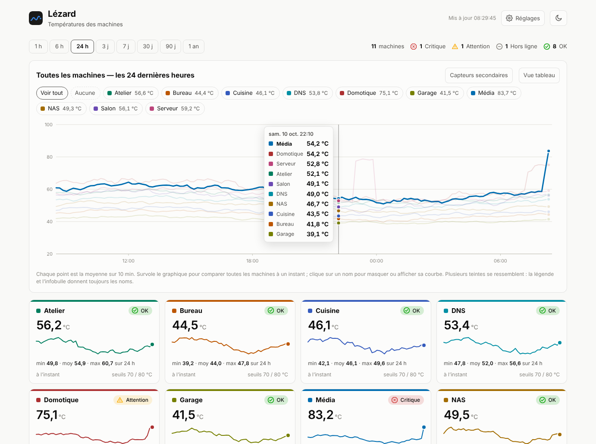
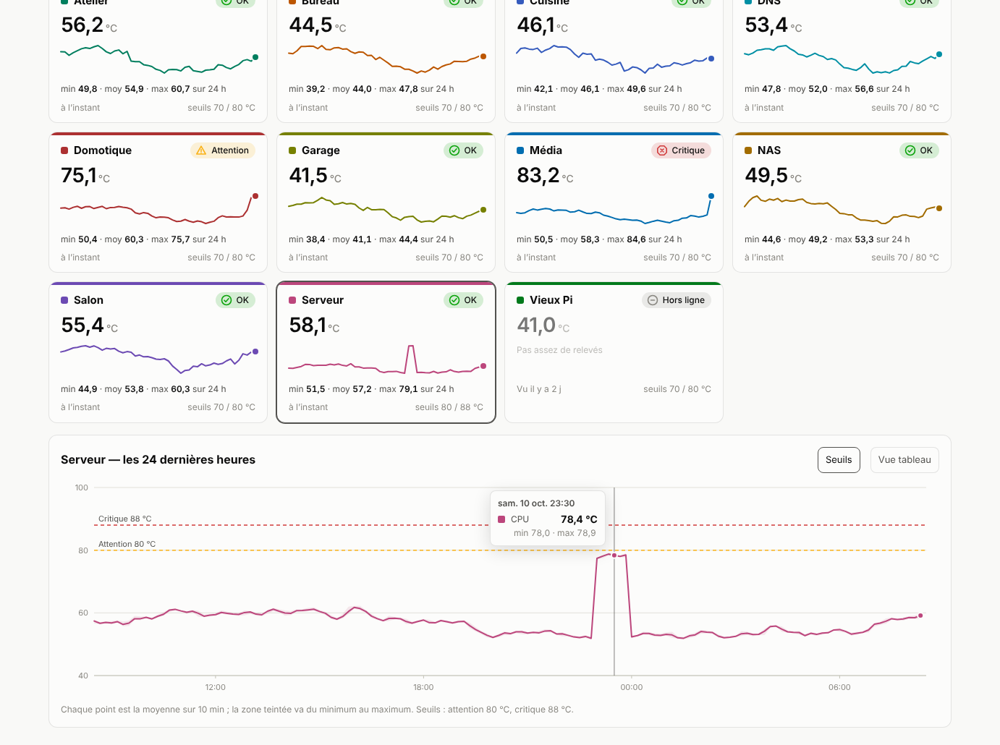
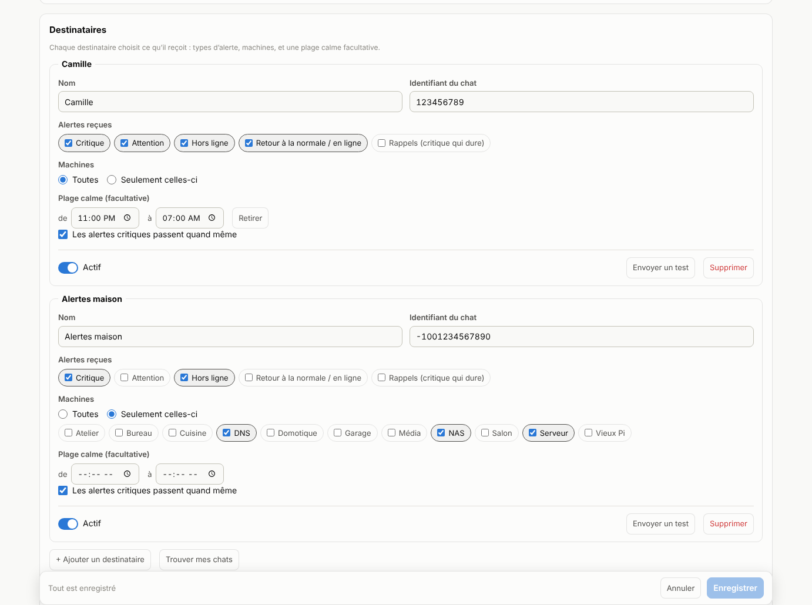

<h1 align="center">🦎 Lézard</h1>

<p align="center">
  <b>La température de vos machines, d'un coup d'œil.</b><br>
  Un tableau de bord léger, sans agent, avec alertes Telegram.
</p>

<p align="center">
  
</p>

Chaque machine envoie sa température par un simple `curl` (cron, chaque minute). Lézard stocke,
affiche et prévient. Rien ne tourne en permanence sur les Pi.

- **Léger** : un binaire Go statique (≈ 7 Mo), ≈ 11 Mo de RAM, aucune dépendance.
- **Lisible** : une carte et une couleur par machine, un graphique de toutes les machines,
  thème sombre et clair.
- **Prévenant** : alertes Telegram réglées depuis l'interface, sans fichier de configuration.

## Aperçu

<p align="center">
  
</p>

## Essayer

Avec des données fictives (Go 1.22 ou plus) :

```sh
go run . -demo
```

Ouvre `http://127.0.0.1:3070`. Mot de passe des Réglages : `demo-admin`.

## Installer

```sh
git clone <url-du-dépôt> lezard && cd lezard
./scripts/make-env.sh   # demande l'IP d'écoute et le mot de passe des Réglages
docker compose up -d --build
```

`make-env.sh` génère le jeton d'envoi et demande le mot de passe des Réglages.
L'interface est sur `http://IP-de-l-hote:3070`.

## Ajouter une machine

Copier `scripts/lezard-push.sh` sur la machine, puis :

```sh
sudo install -m 755 lezard-push.sh /usr/local/bin/lezard-push.sh
read -rsp "Jeton Lézard : " T; echo
printf 'LEZARD_URL=http://IP-de-lezard:3070\nLEZARD_TOKEN=%s\n' "$T" | sudo tee /etc/lezard-push.conf >/dev/null
unset T; sudo chmod 600 /etc/lezard-push.conf
(sudo crontab -l 2>/dev/null; echo '* * * * * /usr/local/bin/lezard-push.sh') | sudo crontab -
```

Le script fonctionne sur Raspberry Pi OS, Debian et CoreELEC (chemins dans l'en-tête du script) ; il demande `curl` 7.55 ou plus récent.
Pour choisir une zone thermique précise : `THERMAL_TYPE=x86_pkg_temp` dans la config.

**Freebox** : `scripts/lezard-freebox.sh` lit la box par son API locale.
Une fois `sudo ./lezard-freebox.sh register` (puis appuyer sur la flèche de la façade), un cron chaque minute suffit.

## Alertes Telegram

<p align="center">
  
</p>

Bouton **Réglages**, protégé par le mot de passe du `.env` :

1. coller le jeton du bot (@BotFather) ;
2. envoyer `/start` au bot, puis « Trouver mes chats » et « Ajouter » ;
3. choisir pour chaque destinataire les alertes reçues, les machines et une plage calme ;
4. activer « Envoyer les alertes » et enregistrer.

| Statut | Règle |
|---|---|
| OK | sous le seuil d'attention (70 °C) |
| Attention | ≥ 70 °C, confirmé 1 min |
| Critique | ≥ 80 °C, envoyé tout de suite, rappel chaque heure |
| Hors ligne | aucun relevé depuis 3 min |

Seuils, noms et couleurs par machine : Réglages, section Machines.

## Réglages principaux

| Variable | Défaut | Rôle |
|---|---|---|
| `LEZARD_TOKEN` | — | jeton d'envoi des machines |
| `LEZARD_ADMIN_PASSWORD` | — | mot de passe des Réglages (10 caractères min.) |
| `LEZARD_STALE` | `3m` | délai avant « Hors ligne » |
| `LEZARD_MAX_SERIES` | `100` | nombre maximal de séries (machine × capteur) |
| `LEZARD_RAW_DAYS` | `3` | jours de relevés bruts, puis moyennes 10 min (30 j) et horaires (400 j) |
| `TZ` | `Europe/Paris` | fuseau des plages calmes |

Les autres variables sont dans `.env.example`.

## Bon à savoir

- `GET /api/health` pour surveiller Lézard (Uptime Kuma, par exemple) : répond 503 si le disque refuse les écritures.
- Lézard parle HTTP et la lecture n'a pas de mot de passe : à garder sur le réseau local.
- Conteneur en lecture seule, non-root, sans capacité Linux.
- Tests : `go vet ./... && go test ./...`
